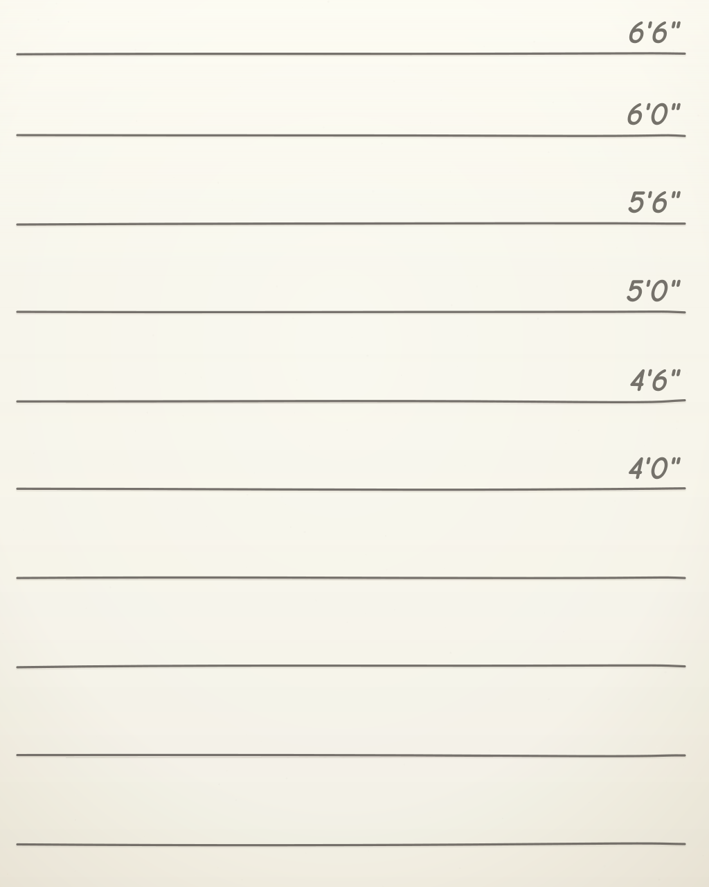
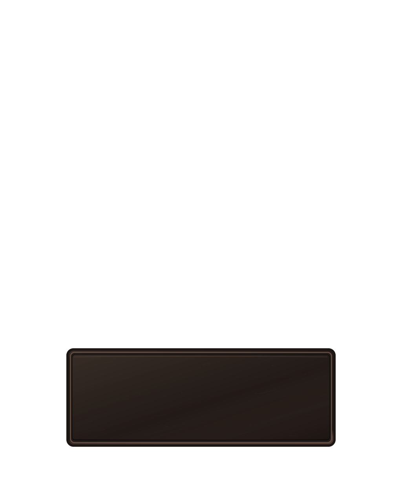

# ART-02 / ART-03 – gemeinsame Messwand und leeres Namensschild

**Charge:** 2026-10-28-01 · **Status:** ENTWURF / REVIEW AUSSTEHEND · **Kein Runtime-Asset und keine Nutzerfreigabe**

## Entwurfsansicht

- [Messwand als SVG](../../../artwork/avatars/v3/background/mugshot_wall.svg)
- [Namensschild als transparente SVG-Ebene](../../../artwork/avatars/v3/frame/nameplate.svg)
- Visueller Review-Kontaktbogen: in der Projektsitzung vom 28.10.2026 als PNG ausgegeben, noch nicht als freigegebener Repository-Asset archiviert.

## Gestaltung und gemeinsame Geometrie

| Eigenschaft | Provisorische Festlegung |
| --- | --- |
| Canvas | 1024 × 1280 Designpixel |
| Hintergrund | unveränderliche cremefarbene Wand mit handgezeichnet wirkenden Linien, keine Spielerauswahl |
| Hintergrund-Layer | vollflächig, deckend, z = 0 |
| Linien-Y | 77, 195, 322, 450, 579, 706, 834, 961, 1091, 1219 |
| Namensschild | x = 172, y = 891, w = 680, h = 245 |
| Namensschild-Layer | transparent außerhalb; später vor Armen und hinter Greiffingern |
| Vorläufige Namens-Safe-Area | x = 242 bis 782, y = 949 bis 1085 (540 × 136) |
| Namen | **nicht** im SVG, dynamisch per Flutter-Renderer |
| Hände/Finger | nicht Bestandteil des Schild-SVG, folgen separat mit ART-04 |

Maße und Anker sind für TECH-01 **vorläufig**, nicht versioniert eingefroren.

## Produktion und technische Sichtprüfung

**Quelle:** eigenständig am 28.10.2026 programmatisch gezeichnete SVG-Grafiken, angelehnt an die zehn vom Nutzer eingebrachten Mugshot-Stilreferenzen in `docs/avatars/references/`. Keine vorhandene Figur und kein fremdes Namensschild herausgeschnitten. Die Messwand-Beschriftung ist als Vektorkontur aus Comic Neue Bold Italic umgesetzt; die Font-Lizenz ist vor einer Veröffentlichung im Rahmen von TT-065 zu prüfen.

**Bisher geprüft:**

- Beide SVG-Quellen auf identischem Canvas (1024 × 1280).
- Separate PNG-Proberasterisierung in 1024 × 1280; das Schild weist außerhalb seiner Kontur echte Transparenz auf.
- Alpha-Bounding-Box des Schild-Proberenders: x = 169..854, y = 888..1139 (inkl. äußerer Kanten).
- Kleinauflösungen 320/96/48 erzeugbar; dies ist **kein** abgeschlossener Sicht-/Performance-Test.
- Beide Teile als voneinander unabhängige Quellen im Git archiviert.

**Noch offen:**

- Explizite Freigabe des gemeinsamen 10er-Masterreviews (ART-01/G0).
- Stilvergleich des Hintergrunds und Schilds im Flutter-Renderer mit tatsächlich transparenten Charakter-Ebenen.
- Textlängen, internationalisierte Namen und Vorderfinger / Griffpunkte im Renderer.
- Validierte 48-/96-/320-px-Sichtprüfung, 20 deterministische Kombinationen und Kantenkontrolle mit echten modularen Teilen.
- Farbmasken, Rechteprüfung (insbesondere Schriftumrisse), finaler Export, Manifest/Runtime-Dateien und technische Freigabe.

## Reviewentscheidung

**Nutzerentscheidung:** ausstehend. Bis zur Freigabe bleiben ART-02 und ART-03 ENTWURF. Die produktive v2-Avataransicht ist unverändert.

**Nächster Schritt:** Nutzer prüft Hintergrund-/Schildansicht. Danach ART-04 + TECH-01 mit einer neu gezeichneten Figur und separaten Alpha-Ebenen; keine Massenproduktion vor bestandenem Prototyp.
